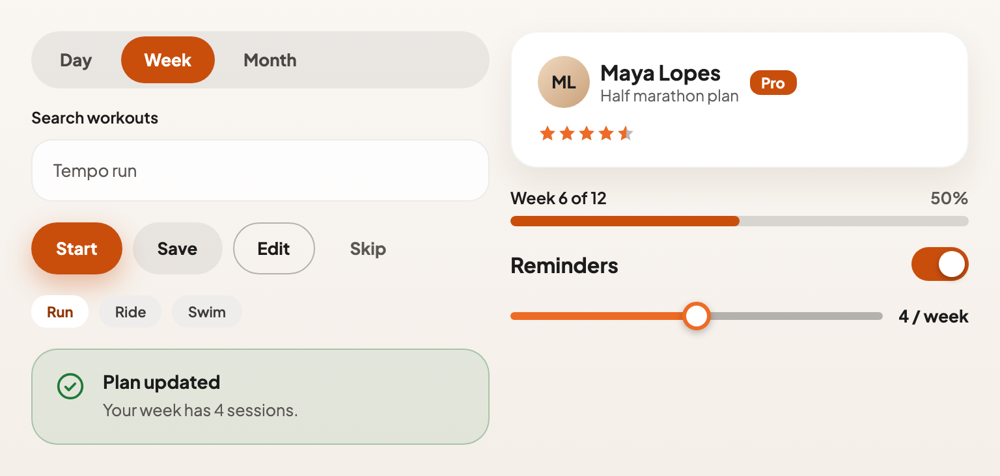

<h1 align="center">
    <picture>
        <source media="(prefers-color-scheme: dark)" srcset="docs/assets/logo-dark.svg" />
        
    </picture>
</h1>

<h3 align="center">Glassy, dark-first React components</h3>

<p align="center">
    <a href="https://www.npmjs.com/package/tintora"></a>
    <a href="https://www.npmjs.com/package/tintora"></a>
    <a href="https://github.com/felipevlourenco/tintora/actions/workflows/release.yml"></a>
    <a href="https://www.npmjs.com/package/tintora"></a>
    <a href="LICENSE"></a>
    <a href="https://github.com/felipevlourenco/tintora/stargazers"></a>
    <a href="https://felipevlourenco.github.io/tintora/"></a>
</p>

Tintora is a lightweight React component library with a glassy, dark-first style. It has a small API surface, is accessible by default, and ships its own TypeScript types. Use it to build polished interfaces without writing the CSS for every button, dialog and menu yourself.

📚 [**Storybook**](https://felipevlourenco.github.io/tintora/) · 📦 [**npm**](https://www.npmjs.com/package/tintora) · 🗒️ [**Releases**](https://github.com/felipevlourenco/tintora/releases) · 🐛 [**Issues**](https://github.com/felipevlourenco/tintora/issues)

<p align="center">
    <picture>
        <source media="(prefers-color-scheme: dark)" srcset="docs/assets/hero-dark.png" />
        
    </picture>
</p>

## 💎 Why Tintora?

- **40+ components**: actions, form controls, data display, feedback and overlays, each with a story for every variant.
- **Accessible by default**: real roles and labels, keyboard support, focus handling and reduced motion respected, checked with axe in the tests.
- **Dark and light themes** from one set of design tokens, following the OS or forced with an attribute.
- **TypeScript-first**: every component exports its props type.
- **Native platform features** where they exist: `<dialog>` for modals and drawers, the top layer for popovers, CSS for animation.
- **Server Components friendly**: components without hooks ship plain, so they work in Next.js without a directive.
- **Self-contained styles**: the ESM build imports its own CSS, with no provider or setup file.
- **Tested in a real browser** as well as jsdom: layout checks run against Storybook in CI.

## 🚀 Getting Started

```bash
pnpm add tintora
# or: npm install tintora
# or: yarn add tintora
```

Requires React 18 or newer.

### Example usage

```tsx
import { useState } from 'react';
import { Button } from 'tintora';

export function Example() {
    const [count, setCount] = useState(0);

    return (
        <Button variant="primary" onClick={() => setCount(count + 1)}>
            {count === 0 ? 'Click me' : `Clicked ${count} times`}
        </Button>
    );
}
```

> [!NOTE]
> The ESM build imports its own stylesheet, so a bundler with CSS support (Vite, Next.js, webpack with `css-loader`) needs nothing else. The CommonJS build does not; add this line there:
>
> ```tsx
> import 'tintora/style.css';
> ```

## 🎨 Theming

Tintora is dark by default and follows the OS preference. Force a theme with `data-theme` on `<html>` or on any wrapper:

```html
<html data-theme="light"></html>
```

Colours, radii, type and shadows are CSS custom properties prefixed `--tintora-`, so you can override them in your own CSS.

## ⚡ Server Components

Components that use hooks or context ship with `'use client'`, and the rest (`Accordion`, `Alert`, `Button`, `Card`, `Chip`, `Dot`, `EmptyState`, `IconButton`, `Link`, `MediaCardSkeleton`, `Pagination`, `Price`, `Rating`, `SearchInput`, `SettingsRow`, `Skeleton`, `Spinner`, `Stepper`, `Table`, `Tag`) are plain. So you can import any of them in a Next.js Server Component without adding the directive yourself:

```tsx
// app/loading.tsx, a Server Component
import { Spinner } from 'tintora';

export default function Loading() {
    return <Spinner />;
}
```

Props passed from a Server Component must be serialisable, so event handlers (`onClick`, `onClose`) belong in a Client Component.

## 🪟 Controlled overlays

Modal, Drawer, BottomSheet and Popover are controlled: your state owns `open`.

```tsx
import { useState } from 'react';
import { Button, Modal } from 'tintora';

export function DeleteWorkout() {
    const [open, setOpen] = useState(false);

    return (
        <>
            <Button variant="secondary" onClick={() => setOpen(true)}>
                Delete
            </Button>
            <Modal
                open={open}
                onClose={() => setOpen(false)}
                title="Delete this workout?"
                description="This cannot be undone."
                actions={
                    <>
                        <Button variant="ghost" onClick={() => setOpen(false)}>
                            Cancel
                        </Button>
                        <Button variant="primary">Delete</Button>
                    </>
                }
            />
        </>
    );
}
```

## 🧩 Components

Every component has a story with all its variants in the [Storybook](https://felipevlourenco.github.io/tintora/).

### Actions

| Component     | What it is                                                                         |
| ------------- | ---------------------------------------------------------------------------------- |
| `Button`      | Four variants, icons, a loading state, and `as` to render a link.                  |
| `IconButton`  | A round, field or nav button with an icon and a required `aria-label`.             |
| `Link`        | An `<a>`, or any component via `as` (e.g. Next's `Link`), in Tintora's style.      |
| `Chip`        | A pill button, or a toggle when `selected` is set.                                 |
| `Toggle`      | A two-option segmented control (`ToggleItem`), such as light and dark.             |
| `Tabs`        | A tab list (`Tab`), as a segmented pill or an underline. Arrow-key navigation.     |
| `Pagination`  | Page numbers with previous and next. Buttons, or links with `getHref`.             |
| `Breadcrumbs` | The trail to the current page. `linkAs` for a router link, `maxItems` to collapse. |

### Forms

| Component       | What it is                                                                      |
| --------------- | ------------------------------------------------------------------------------- |
| `TextField`     | A labelled input with hint and error messages. `type="date"` for a date picker. |
| `Combobox`      | A `Select` you type into: the list narrows to what matches.                     |
| `SearchInput`   | A search field with a search icon and a required `aria-label`.                  |
| `Select`        | A select with a listbox popup that can submit with a form.                      |
| `Switch`        | An on/off switch.                                                               |
| `Checkbox`      | A checkbox with an indeterminate state.                                         |
| `Radio`         | A radio, grouped with `RadioGroup`.                                             |
| `SettingsRow`   | A row for one setting: title, description and a control on the side.            |
| `QuantityInput` | A whole number with minus and plus buttons, for a cart.                         |
| `Slider`        | A range input with the filled track in the accent.                              |
| `Textarea`      | A labelled multi-line field with hint and error, like `TextField`.              |
| `RatingInput`   | A star rating the user sets: radio buttons drawn as stars.                      |

### Display

| Component           | What it is                                                                                     |
| ------------------- | ---------------------------------------------------------------------------------------------- |
| `Avatar`            | An image with an initials fallback.                                                            |
| `Card`              | A surface or list-row card, and a selectable variant (`SelectableCard`).                       |
| `MediaCard`         | A card of slots: media, badge, action, title, meta and footer. The title link covers the card. |
| `MediaCardSkeleton` | A shimmering placeholder with a `MediaCard`'s layout, for loading grids.                       |
| `MediaCarousel`     | A picture with floating arrows and a strip of thumbnails (hidden on small screens).            |
| `Tag`               | A small label in `neutral`, `success`, `accent` or `card`.                                     |
| `Dot`               | An unread, read or section-tick marker.                                                        |
| `Rating`            | A read-only star rating, with fractions and an optional count.                                 |
| `Price`             | A formatted price, with the original struck through when on sale.                              |
| `Table`             | Styles native table markup, with a scroll box, density and aligned numbers.                    |
| `Accordion`         | Sections that open and close (`AccordionItem`), on native `<details>`.                         |
| `EmptyState`        | An icon, a title, a line of text and an action for a list with nothing in it.                  |

### Feedback

| Component     | What it is                                                            |
| ------------- | --------------------------------------------------------------------- |
| `Alert`       | An inline status message, or a full-width announcement bar.           |
| `Toast`       | A short-lived message with an action, a timer bar and pause on hover. |
| `ProgressBar` | Determinate or indeterminate progress.                                |
| `Spinner`     | A loading indicator in three sizes.                                   |
| `Stepper`     | Checkout-style progress: complete, current and upcoming steps.        |
| `Skeleton`    | A shimmering placeholder.                                             |

### Overlays

| Component     | What it is                                                                                                             |
| ------------- | ---------------------------------------------------------------------------------------------------------------------- |
| `Tooltip`     | A hint on hover and focus: optional title, shortcut and icon, start/end alignment, fixed light or dark tone, no arrow. |
| `Popover`     | A small floating panel anchored to a trigger. Flips at the viewport edge.                                              |
| `Menu`        | A menu of actions (`MenuItem`, `MenuSeparator`) that opens from a button. Arrow keys, Esc, outside click.              |
| `Modal`       | A dialog on native `<dialog>`: focus trap, Esc, scrim click, scroll lock.                                              |
| `Drawer`      | A panel that slides in from any edge. A scrim click or Esc closes it.                                                  |
| `BottomSheet` | A `Drawer` from the bottom with a grabber, a title and `BottomSheetOption` rows.                                       |

## 🛠️ Development

```bash
pnpm install       # dependencies
pnpm storybook     # Storybook on http://localhost:6006
pnpm test          # unit tests (Vitest, Testing Library, axe)
pnpm test:layout   # layout checks in a real browser (Playwright, against Storybook)
pnpm lint          # ESLint and token check
pnpm typecheck     # TypeScript
pnpm build         # library build in dist/
```

> [!NOTE]
> `pnpm test:layout` starts Storybook on its own. Install the browser once with `pnpm exec playwright install chromium`.

### Project structure

```text
src/
  <Component>/
    <Component>.tsx          the component
    <Component>.css          its styles
    <Component>.stories.tsx  Storybook stories
    <Component>.test.tsx     tests
  hooks/                     shared hooks (outside press, escape key, ...)
  utils/                     shared helpers
  tokens.css                 design tokens, dark and light
  index.ts                   public exports
docs/                        Storybook documentation pages and assets
e2e/                         layout checks that need a real browser
scripts/                     lint checks for tokens and 'use client'
```

## 🤝 Contributing

Contributions are welcome.

- 🌿 `main` is protected, so work on a branch and open a pull request.
- ✍️ Commits follow [Conventional Commits](https://www.conventionalcommits.org/), checked by a hook. The commit type decides the next version (see [Releases](#-releases)).
- 🧪 A new component comes with tests, a story for every variant and a row in the [component tables](#-components). A layout bug that jsdom cannot see gets a check in `e2e/`.
- 🐛 Found a bug or want a component? [Open an issue](https://github.com/felipevlourenco/tintora/issues).

## 📦 Releases

Versions are published automatically on every merge to `main` with [semantic-release](https://semantic-release.gitbook.io/), from the commit messages:

| Commit                                  | Release |
| --------------------------------------- | ------- |
| `fix:`, `perf:`, `refactor:`, `revert:` | patch   |
| `feat:`                                 | minor   |
| `BREAKING CHANGE:` footer, or `feat!:`  | major   |
| `docs:`, `chore:`, `style:`, `test:`    | none    |

## 📄 License

[MIT](LICENSE)
